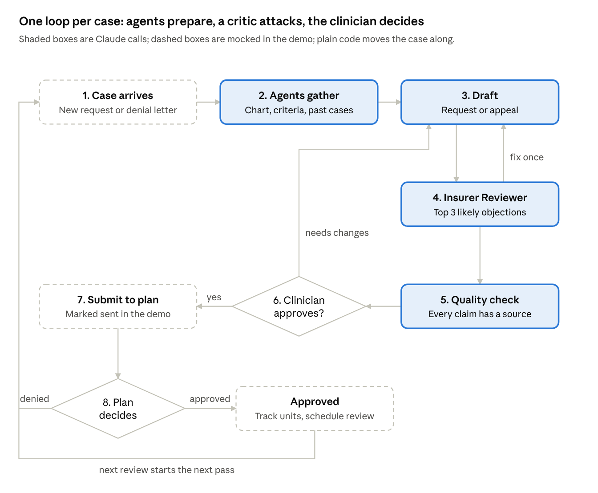

# Agentic loop

Every case goes around the same 8-step loop, whether it starts as a new request or a denial.

There are three feedback loops:

1. **Insurer Reviewer to drafter:** objections go back to the drafter once.
2. **Clinician to agents:** the clinician can send a draft back with requested changes.
3. **Plan to the loop:** a denial from the plan starts the next pass.

An approval leads to tracking, and the next concurrent review starts the loop again.

The loop is driven by the code orchestrator, not by an LLM deciding what to do next. See [agents](agents.md) and [decisions](decisions.md#plain-code-orchestrator).
