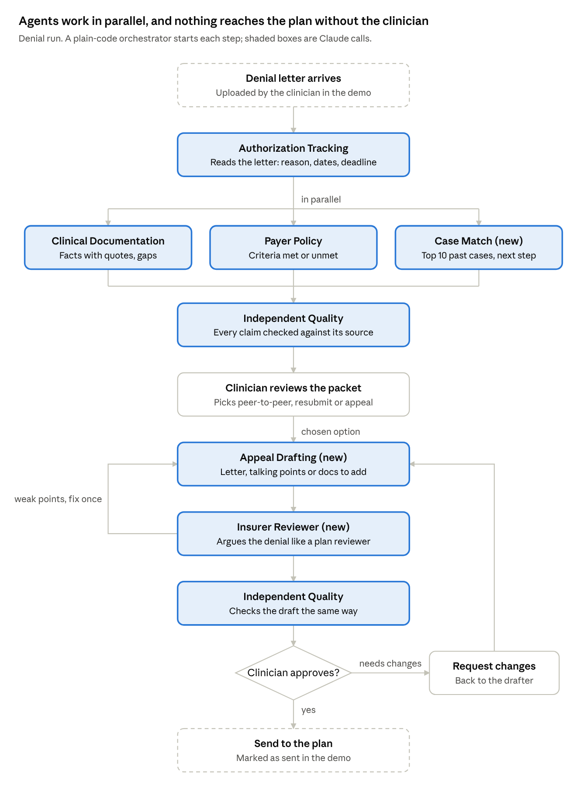

# Agents

A plain TypeScript orchestrator on the Next.js server decides which agents run and in what order. It is ordinary code, not an LLM, which keeps runs predictable, testable and cheap. Each agent is one Claude call with its own instructions, and it returns structured JSON. Every fact an agent states carries a quote from its source. That is what "source-linked facts" means on the clinician's screen.

**Count:** 7 LLM agents plus the code orchestrator.

| Agent | Reads | Returns | Notes |
| --- | --- | --- | --- |
| Orchestrator | Case status | Which agents run next | Plain code, no API cost |
| Clinical Documentation (Umer) | Intake, treatment plan, progress notes | Facts with quotes, plus missing items (for example, no discharge plan) | Runs on every case |
| Payer Policy (Umer) | Those facts, plus the public criteria summary (LOCUS, ASAM) | Each criteria dimension marked met, unmet or unclear, with the supporting quote | Runs on every case |
| Authorization Tracking (Umer) | Request, denial letter | Plan, level of care, dates, units, denial reason, appeal deadline | Mostly code. The LLM only parses the denial letter into fields |
| Case Match (new) | Facts, plus the 10 closest NY and CA cases | The 3 to 5 most similar cases, what won or lost, and a recommended next step | Code picks the 10 cases first by care type and keywords, so the LLM never reads the whole dataset |
| Insurer Reviewer (new) | The request or appeal draft, plus similar upheld cases | The 3 most likely objections, each with the evidence that would answer it | Adversarial. Runs once per run |
| Appeal Drafting (new) | Everything above, plus the clinician's chosen option | An appeal letter, peer-to-peer talking points or a list of documents to add | Runs only after the clinician picks |
| Independent Quality (Umer) | The packet or draft, plus the sources | Any claim without a supporting quote, and which agent must fix it | Runs last, every time. Its flags drive the "request changes" loop |

## The two runs

**New request (denial prevention):** Documentation, Policy and Case Match run in parallel. Then the Insurer Reviewer, then Quality, then the clinician, who fixes weak spots before submitting.

**Denial:** Tracking reads the letter. Then Documentation, Policy and Case Match run in parallel. Then Quality and the clinician's choice. Then Drafting, the Insurer Reviewer (one fix round for the drafter), Quality again, and the clinician's final approval.

## Insurer Reviewer: the adversarial agent

This agent reads a request the way a health plan's reviewer would and tries to find a reason to deny it. Its main job is **prevention**: it runs before the first request goes out, so the clinician can fix weak spots instead of appealing later. Ritten's JD calls this "denial prevention." The same agent runs again on appeal drafts.

It asks four questions that any plan reviewer asks, whatever the company:

1. Could this patient be treated safely at a lower level of care?
2. Is each criteria dimension backed by a quote from the chart?
3. Is there a discharge plan with a date and a step down?
4. Do the intake, the treatment plan and the notes tell the same story?

It doesn't rely on any one insurer's rules. Its objections are grounded in the 592 upheld NY behavioral-health cases (608 before cleaning), which cover many plans. When a request resembles an upheld case, it quotes the reason that reviewer gave, for example minimal withdrawal scores and an uncomplicated stay in packet B. The objections double as peer-to-peer preparation.

**How often:** once per run, not after every agent. Running it after each step multiplies cost and mostly repeats itself, because the earlier agents produce pieces, not a request a plan would see. The drafter gets one round to fix its objections.

## Procedural checks for appeals

The Appeal Drafting agent also checks the denial's process, not just the clinical case:

- Was the denial made by a qualified clinician?
- Does it apply stricter rules to behavioral health than to medical care, which mental health parity law prohibits?
- Did the plan say which guidelines it used?

These work for any plan, so they don't depend on one insurer's policy.
