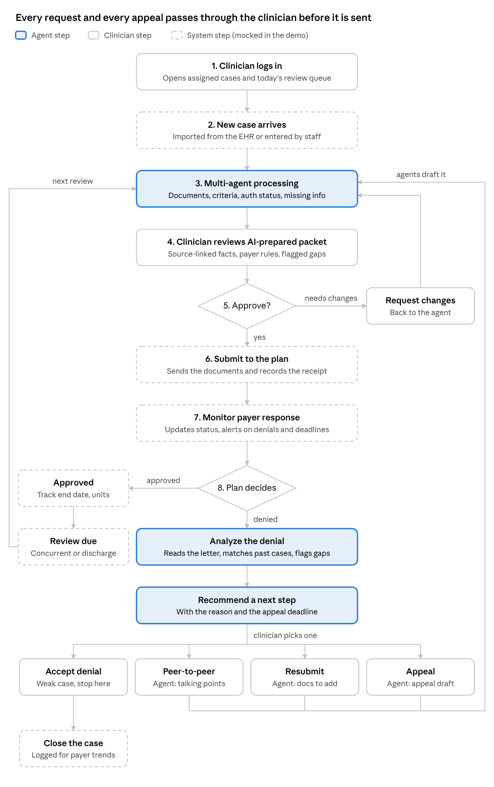

# User flow

This combines Jonathan's flow with Umer's. Everything the agents draft, whether a first request, a concurrent review or an appeal, goes back through the same clinician review before anything is sent.

## Steps

1. **Clinician logs in**
2. **New case arrives** (a new authorization request, a concurrent review that's due, or a denial)
3. **Multi-agent processing** (see [agents](../architecture/agents.md))
4. **Clinician reviews the AI-prepared packet**
5. **Approve?** If not, the clinician requests changes and it goes back to step 3.
6. **Submit to the plan**
7. **Monitor the payer response**
8. **Plan decides**

### If approved (happy path)

The app records the approval and tracks the authorized days or units. When the next concurrent review is due, the case goes back to step 3.

### If denied

1. The app reads the denial letter and pulls the reason and the appeal deadline.
2. It finds similar overturned and upheld cases and recommends a next step.
3. The clinician chooses one of four options:
   - **Accept** the denial (step down to a lower level of care)
   - **Peer-to-peer** (the app prepares talking points)
   - **Resubmit** with added documentation
   - **Appeal** (the app drafts the letter)
4. Anything drafted goes back to the agents and then to clinician review (steps 3 to 5).

An upheld appeal comes back through "Plan decides" as a new denial, so the next appeal level needs no separate path.

## Demo shortcuts

The steps that need EHR and payer connections (case arrival, submission, payer response) are faked in the class demo with an upload button and a status the presenter sets by hand.
